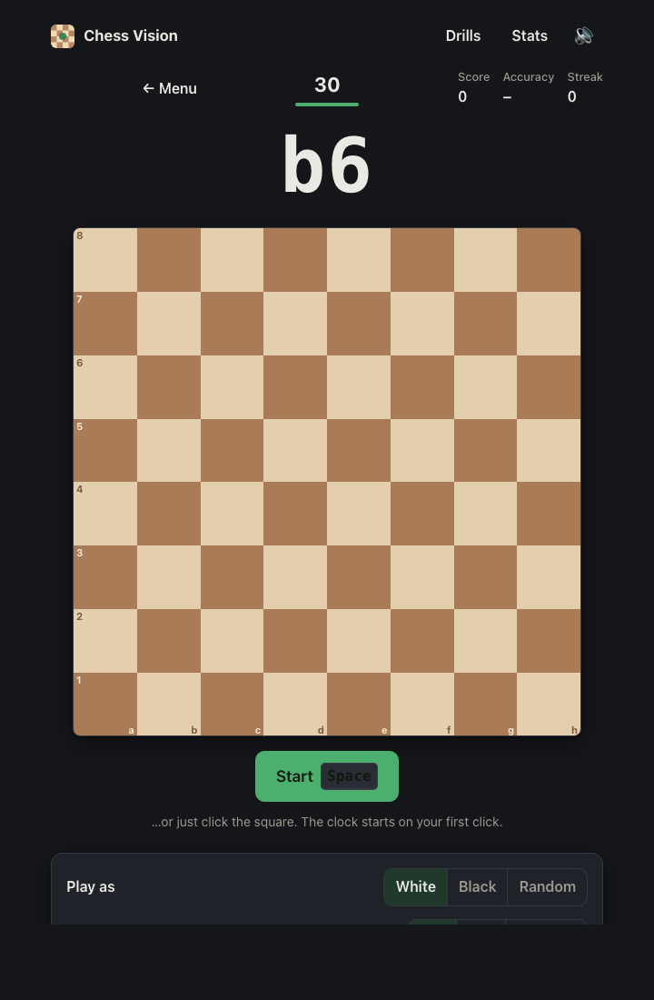
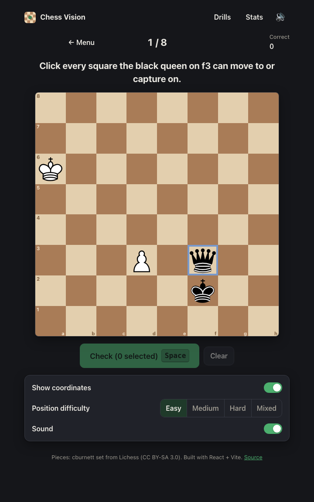

# Chess Vision Trainer

A small, fully client-side web app that trains chess board vision: first knowing every
square's name instantly, then reading whole positions from FEN without seeing a board.

**Live:** https://xackerlud.github.io/chess-vision-trainer/

<p align="center">
  
  
</p>

## Features

| Mode | What you do |
| --- | --- |
| **Find the square** | A square name (e.g. `b5`) appears; click it on the board. 30 s / 60 s / untimed rounds, instant green/red feedback, streaks. |
| **Name the square** | The reverse drill: a square lights up and you type its name, or pick from 4 options in easy mode. |
| **FEN → board** | Read a FEN string and place the pieces on an empty board with a piece palette. Every square is marked right / wrong / missing. |
| **Board → FEN** | See a position and type the piece-placement field. The first wrong rank is highlighted in the text and on the board. |
| **Blindfold** | Only the FEN is shown. Answer questions like *What is on e2?*, *Is the black king in check?*, *Can white still castle queenside?*, then the board is revealed. |
| **Piece vision** | Click every square a knight / bishop / rook / queen can move to, blockers included. Checked with chess.js move generation. |

Plus:

- **Stats page**: best score and rounds played per mode, accuracy trend over the last 20 rounds, and a
  **weak-squares heatmap** that shows which squares you keep missing.
- Settings persisted in `localStorage` (play as White / Black / Random, coordinates on/off, round length,
  sound, position difficulty). The app keeps working if storage is unavailable.
- Keyboard shortcuts: `Space` starts / restarts a round, `Esc` returns to the menu.
- Short sound cues with a mute toggle (off by default on touch devices).
- Light and dark theme following the system setting; responsive down to phone widths.
- ~100 bundled positions tagged easy / medium / hard, all validated with chess.js.
- No backend, no accounts, no tracking.

## Tech

React 19 + TypeScript, bundled with Vite. Plain CSS. `chess.js` is used only for FEN validation,
check detection, castling rights and move generation; the board itself is rendered with CSS grid.
Unit and component tests run on Vitest + Testing Library. Deployed to GitHub Pages by GitHub Actions.

## Run locally

```sh
npm install
npm run dev        # http://localhost:5173
npm test           # run the test suite once
npm run test:watch
npm run build      # production build into dist/
npm run preview    # build with base "/" and serve it locally
```

The production `base` path defaults to `/chess-vision-trainer/` for GitHub Pages. Override it with
`VITE_BASE=/ npm run build` for any other host.

## Deploy

Pushing to `main` runs `.github/workflows/deploy.yml`: install → test → build → deploy to GitHub Pages.
In the repository settings, set **Pages → Source** to **GitHub Actions** once. The base path is derived
from the repository name, so renaming the repo keeps working.

## Project structure

```
src/
  components/   Board, Square, Piece, Timer, ScoreBar, EndScreen, SettingsPanel, Menu, StatsView, ...
  modes/        FindSquare, NameSquare, FenToBoard, BoardToFen, Blindfold, PieceVision
  hooks/        useDrill (timed rounds), useSetRound (N-item rounds), useSettings, useStats, useHashRoute
  lib/          squares.ts, random.ts, storage.ts, fen.ts, stats.ts, questions.ts, pieceVision.ts, positions.ts
  data/         positions.json (generated by scripts/gen-positions.mjs)
  styles/       app.css
tests/          Vitest unit tests for lib/ and component tests for the drills
```

## Credits

- Piece images: the **cburnett** set by Colin M.L. Burnett, as distributed by
  [Lichess](https://github.com/lichess-org/lila/tree/master/public/piece/cburnett), licensed under
  [CC BY-SA 3.0](https://creativecommons.org/licenses/by-sa/3.0/) / GPLv2+ / BSD.
- [chess.js](https://github.com/jhlywa/chess.js) (BSD-2-Clause) for FEN parsing and move generation.

## License

MIT for the application code. Piece images keep their own license (see above).
